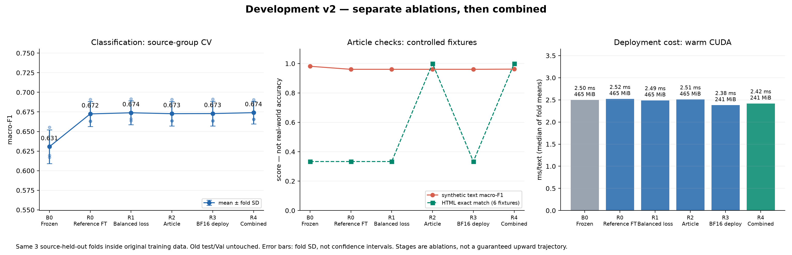

# Artikel-Sentiment — second-path

Eigenständiger Lösungsweg ab dem leeren Commit `830bba1`. Kein Code und kein Merge aus `main`.

## Entwicklung v2 und aktueller API-Standard

Auf ausdrücklichen Wunsch folgten getrennte Verbesserungsversuche und eine Kombination. Damit wurde die ursprüngliche Vorgabe „genau ein stärkeres Modell“ für diese **zusätzliche dokumentierte Entwicklungsphase** erweitert; der v1-Lauf bleibt unverändert erhalten. Die nachfolgenden v1-Abschnitte beschreiben den historischen ersten Stand. Aktuell wird der in v2 ausgewählte BF16-Stand ausgeliefert.

**Ausgeliefert wird `R3_deploy`, weil sein mittleres Quellen-CV-macro-F1 von 0,6729 innerhalb der vorab definierten 0,005 zur besten Kombination (0,6740) liegt und die Tie-Regel die geringere gemessene Latenz bei rund 241 MiB wählt.** Das ist keine behauptete signifikante Überlegenheit: der Abstand beträgt nur 0,0011 F1 bzw. 0,037 ms zur Kombination. Gegenüber dem Referenz-Fine-Tune sinkt die vollständige Artefaktgröße von rund 465 auf 241 MiB.

- **B0:** eingefrorene Baseline, je Fold ausschließlich auf dessen Fit-Zeilen neu gefittet.
- **R0:** ursprüngliche Fine-Tune-Rezeptur, drei Epochen, je Fold neu trainiert.
- **R1:** isoliert die Verlustgewichtung nach Sprache×Klasse.
- **R2:** isoliert tokengewichtete Chunks und verbesserte HTML-Extraktion.
- **R3:** isoliert BF16-Speicherung/-Inferenz; zusätzlich begrenztes Warten auf die API-Inferenz und Prüfung gültiger Scores.
- **R4:** kombiniert R1, R2 und R3. Der beste mittlere CV-Punktwert führt wegen der vorab festgelegten Nähe-/Zeit-Regel nicht automatisch zur Auslieferung.

**18 abgeschlossene Fold-Läufe:** identische drei `StratifiedGroupKFold`-Folds innerhalb der ursprünglichen 8.335 Train-Zeilen, Gruppe=`source`, Schicht=`language:label`, Seed `20261019`. Die Quelle eines Dev-Folds kommt nie in dessen Fit-Fold vor. Die alten Val- und Testdateien wurden weder für Entwicklung noch Auswahl neu geöffnet oder bewertet. Die beiden Trainingsrezepturen durchlaufen immer den gesamten jeweiligen Fit-Fold, beim Release alle 8.335 Train-Zeilen. Es gibt keine Hyperparametersuche auf Val/Test und kein Early Stopping.



[Entwicklungsbericht und Trade-offs](reports/development/development.md) · [CV-Läufe](reports/development/runs.json) · [vorab festgelegtes Protokoll](reports/development/protocol.json) · [eingefrorene Entscheidung](reports/development/decision.json). Die synthetischen Artikeltexte und sechs HTML-Fixtures sind technische Kontrollfälle, **keine realen Artikellabels**. R2/R4 verbessern die HTML-Fixtures von 2/6 auf 6/6; diese Artikelverarbeitung ist nicht Teil des durch die Zeit-Tie-Regel gewählten R3-Standards. R2/R4 bleiben als getrennte lokale Fold-Artefakte nachvollziehbar. 51 netzfreie Tests prüfen API, Abruf, Chunk-Aggregation, Überlastbehandlung und ungültige Scores. `SENTIMENT_QUEUE_TIMEOUT` begrenzt die Wartezeit vor Inferenz (Standard 2 s, bei Überlast 503 plus `Retry-After`). Ein bewusst strenger 10-ms-Lasttest zeigt die Gegenleistung: schnelle Ablehnung statt mehr erfolgreich abgearbeiteter Anfragen; seine 503-Antworten sind keine erfolgreiche Inferenz und kein Durchsatzgewinn.

### Abschließender Vergleich mit dem Kollegen — erst nach unserer Auswahl

Ein frischer **gemeinsamer** Benchmark prüft die unverändert rekonstruierte Main-Standardmethode und unsere eingefrorenen v1-/v2-Artefakte. [Vollständiger Vergleich](reports/development/branch_comparison.md), [Maschinenwerte](reports/development/branch_comparison.json), [Benchmark-Herkunft/Filter/Lizenzen](reports/development/benchmark_manifest.json).

| Lösung | macro-F1 EN nativ | macro-F1 DE maschinenübersetzt | ms/Text | MiB |
| --- | ---: | ---: | ---: | ---: |
| Main-Standard, unverändert rekonstruiert | 0,4524 | 0,4293 | 0,250 (CPU) | 4,08 |
| Second-path v1 | 0,7360 | 0,6458 | 2,335 (CUDA) | 465,14 |
| Second-path v2, vorab gewählt | 0,7293 | 0,6557 | 2,326 (CUDA) | 240,73 |

Quelle: 600 neue [SEntFiN](https://github.com/pyRis/SEntFiN)-Headlines mit einstimmigen menschlichen Entitätslabels, je 200/Klasse, plus deren deutsche Übersetzungen mit [OPUS-MT](https://huggingface.co/Helsinki-NLP/opus-mt-en-de). Kein exakter normalisierter Überlapp mit beiden Trainingskorpora; keine Aussage über semantischen oder Vortrainingsüberlapp. **Deutsch ist ein MT-Transfercheck, kein nativer Goldtest; es sind 600 Titelpaare, keine 1.200 unabhängigen Artikel.** Die Labels/Benchmarkzahlen beeinflussten die bereits eingefrorene Auswahl nicht. Native EN-Differenz v2 minus Kollege: +0,2770 macro-F1, gepaarter Bootstrap-95-%-Perzentilbereich [0,2257; 0,3249] unter diesem Benchmark.

V2 ist **kein pauschaler Genauigkeitsgewinn** gegenüber v1: auf nativen EN-Headlines fällt der Punktwert leicht, auf DE-MT steigt er leicht. Der klare v2-Gewinn ist die kleinere Verpackung bei ähnlicher CV-Qualität; die bessere Evidenz macht Grenzen und erfolglose/kleine Änderungen sichtbar. Main bleibt erheblich kleiner und schneller. Unterschiedliche Trainingskorpora bedeuten, dass dieser Vergleich gelieferte Verfahren prüft und keinen isolierten Architekturvorteil beweist. Die alten 0,720 und 0,7187 werden nicht als gemeinsame Rangliste verwendet.

### Aktuellen Stand frisch reproduzieren

Nach dem CUDA-/Python-Setup unten, in einem **frischen Clone**. Die historischen Messergebnisse bleiben unter `reports/development/`; neue Ergebnisse gehen nach `reports/reproduction/` (ignoriert):

```bash
export SENTIMENT_DEV_REPORTS=reports/reproduction
python -m src.prepare
python -m src.train frozen
python -m src.development run
python -m src.development summarize
python -m src.development release
python -m src.service_benchmark
python -m src.development_report
python -m src.development activate
uvicorn app.main:app --host 127.0.0.1 --port 8000
```

Abgeschlossene Läufe und die Auswahl sind lokal gegen Wiederholung gesperrt. `--resume` ist ausschließlich für unvollständige Entwicklungsstufen vorgesehen und prüft den Protokollhash; ein Harness-Abbruch mit erhaltener fehlgeschlagener MLflow-Ausführung ist in `reports/development/harness_incident.json` dokumentiert. Keine neue Auswertung des ursprünglichen Tests. Die ursprünglichen Gewichte bleiben unter `models/finetuned`, der aktuelle vollständige Release unter `models/development/release`, der Rücksprungverweis unter `models/development/previous_selected.json`. Die API lädt nur das lokal ausgewählte Artefakt und lädt nichts herunter. Rücksprung zu v1: `cp models/development/previous_selected.json models/selected.json`, danach Uvicorn neu starten. Bei frischer v2-Reproduktion existiert noch kein v1-Release; entsprechend ist dessen Vergleich optional und wird mit der unten beschriebenen Referenz-v1-Initialisierung hergestellt, ohne den alten Test auszuführen.

Für den **optionalen letzten** gemeinsamen Vergleich braucht man zusätzlich `requirements-evaluation.txt` und einen separaten detached Referenzcheckout. Niemals deren CPU-Transformer-Requirements installieren. Die tatsächlich benutzte Referenzumgebung steht in `reports/development/reference_requirements.txt`. Ausführbare Schritte stehen im [Vergleichsbericht](reports/development/branch_comparison.md). Der Adapter importiert unveränderte Methoden, enthält keine kopierte Modellimplementierung und schreibt ausschließlich in unser MLflow-Experiment. Modelle und Datentexte bleiben uncommittet. `main` bleibt unverändert.

## Problem und Entscheidung

Medienbeobachtung und PR sollen deutsche oder englische Nachrichten nach `negative`, `neutral`, `positive` vorsortieren: Was muss wegen negativer Entwicklung geprüft werden, was ist eine sachliche Meldung, was ist positiv belegbar? Ziel ist das Sentiment des eingereichten Textes, keine Tatsachenprüfung, Dringlichkeitsmessung oder Anlageempfehlung. Fehlalarm und übersehene negative Meldung haben noch unbekannte Kosten. Deshalb ist **macro-F1** das vorab festgelegte Auswahlmaß: jede Klasse zählt gleich. Bei höchstens 0,005 absolutem Abstand entscheiden geringere Inferenzzeit, danach weniger Artefaktbytes. Es gibt keine Parametersuche auf Val oder Test.

## Ursprünglicher Modellweg (v1, historischer Meilenstein)

Ein mehrsprachiger semantischer Encoder ersetzt Wortzählvektoren: [paraphrase-multilingual-MiniLM-L12-v2](https://huggingface.co/sentence-transformers/paraphrase-multilingual-MiniLM-L12-v2), Apache-2.0, Revision `e8f8c211226b894fcb81acc59f3b34ba3efd5f42`. Maskiertes Mittel seiner 384-dimensionalen Tokenrepräsentationen. Die Modellkarte beschreibt 50 Sprachen und Kontext 128.

1. **`frozen`, echte trainierte Baseline:** Encoder eingefroren, LogisticRegression auf den Train-Embeddings, C=1, inverse Klassenhäufigkeit, max_iter=2000. Der gelernte Kopf wird als lineare Torch-Schicht gespeichert. Extraktion und Inferenz laufen auf CUDA.
2. **`finetuned`, genau ein stärkeres Modell:** derselbe Encoder und Initialisierung mit dem Baseline-Kopf; **alle Encodergewichte** und Kopf werden auf dem vollen Train-Split aktualisiert. Drei feste Epochen, Batch 32, Kontext 128, BF16, AdamW, Encoder-Lernrate 2e-5, Kopf 2e-4, Weight Decay 0,01, 10 % Warmup, linearer Abfall, Gradient Clipping 1, inverse Klassenhäufigkeit in Cross-Entropy. Es wird ausschließlich der Stand nach Epoche 3 gespeichert. Kein Early Stopping und keine Checkpoint-Auswahl.
3. **`centroid`, geometrischer Vergleich:** derselbe eingefrorene Encoder, je Klasse das Train-Mittel; kleinster quadrierter euklidischer Abstand. Keine Parameteroptimierung. Als linearer Kopf mit `2*c` und Bias `-||c||²` gespeichert.
4. **`majority`, Plausibilitätskontrolle:** immer die häufigste Train-Klasse. Diese Kontrolle allein wäre keine ausreichende Baseline.

Begründung: Der gemeinsame semantische Raum kann deutsche und englische Formulierungen verbinden. Der direkte Vergleich `frozen` gegen `finetuned` misst den Mehrwert der Domänenanpassung bei identischem Encoder und Kontext, statt nur ein größeres Modell hinzuzufügen. Centroid prüft, wie viel ein diskriminativ gelernter Kopf beiträgt. Keine TF-IDF, kein LinearSVC und kein fertiges Sentiment-Zero-Shot-Modell.

## Daten und Herkunft

[Kenpache/multilingual-financial-sentiment](https://huggingface.co/datasets/Kenpache/multilingual-financial-sentiment), ausschließlich DE und EN, Datei `all_languages_clean.csv`, feste Revision `9d43950d151602f623f28bba62f30554b5d40dd2`. Die Quelle enthält kurze Finanznachrichtensätze aus Medien, etwa FAZ/Handelsblatt und CNBC/Reuters. Die vorgegebenen Labelnamen werden unverändert übernommen. Finanzielle Entwicklungen tragen die gewünschte Vorsortierentscheidung; die Übertragung auf allgemeine Politik-, Kultur- oder ganze Nachrichtenartikel bleibt eine Grenze.

**Lizenz und Nutzung:** Die [Quellenkarte](https://huggingface.co/datasets/Kenpache/multilingual-financial-sentiment/blob/9d43950d151602f623f28bba62f30554b5d40dd2/README.md) nennt Apache-2.0, schränkt die Nutzung im Text aber auf akademische und nichtkommerzielle Forschung ein. Hier gilt diese engere Nutzung; Rechte der Verlage bleiben bestehen. Annotation, Annotatorübereinstimmung und Artikel-IDs sind nicht hinreichend dokumentiert. Es werden weder Daten noch Gewichte weiterverteilt. PR ist der fachliche Stakeholder, keine Freigabe für kommerziellen Betrieb.

**Filter:** 39.829 Quellzeilen → 11.910 DE/EN-Zeilen mit gültigem Label → 11.909 nach Ausschluss fehlender Texte und Längen außerhalb 20–20.000 Zeichen. Genau eine Zeile war kürzer als 20 Zeichen. Unicode-NFKC, Whitespace-Normalisierung und Casefold ergeben den Duplikatschlüssel; widersprüchlich gelabelte Schlüssel würden vollständig entfernt, sonst bleibt eine Zeile. In dieser Revision: 0 Konfliktzeilen, 0 Duplikate. Keine Inhaltsfilter anhand des Sentiments.

**Split, einmal geschrieben:** Nach stabiler Sortierung der SHA-256-Text-IDs mit Seed **20261018**, geschichtet nach `language:label`: zuerst 15 % Test, danach `0.15/0.85` vom Rest Val. Train 8.335, Val 1.787, Test 1.787. Jede Sprache enthält alle drei Klassen. Val wird nur für die Dateiintegrität gehasht, nicht für Metriken, Training, Hyperparameter oder Modellwahl gelesen. Exakte normalisierte Duplikate können nicht zwischen Splits liegen; ähnliche Sätze, dieselbe Quelle oder dasselbe Ereignis können es weiterhin. Ohne Artikel-/Ereignis-ID ist kein belastbarer Ereignis-Gruppensplit möglich.

Die Split-Hashes und Klassen-/Sprachzahlen stehen in [reports/data_manifest.json](reports/data_manifest.json). Test-SHA256: `7337d5e4423d90bbf54fbd6ec26938adf6b197d4dc92a72e31c8b570879391bd`. Das ist **ein eigener Split**. Die Zahlen sind **nicht mit 0,720 auf main vergleichbar**, auch wenn ein Teil der Datenquelle gemeinsam ist. Phrasebank ist hier nicht enthalten.

## Setup auf dem Tower

Im Repository-Root, Python **3.12**, Linux, NVIDIA-Treiber. Gemessen auf RTX 5060 Ti, 16 GB; Treiber 595.71.05. Das CUDA-12.8-Wheel unterstützt diese Blackwell-GPU; das installierte Treibermaximum 13.2 ist kein Grund, ein CPU-Wheel zu installieren. Ein separates CUDA-SDK ist nicht nötig.

```bash
nvidia-smi
python3.12 -m venv .venv
source .venv/bin/activate
python -m pip install --upgrade pip
python -m pip install -r requirements-cuda.txt
python -m pip install -r requirements.txt
python -m pip check
python -c 'import torch; assert torch.cuda.is_available(); print(torch.__version__, torch.version.cuda, torch.cuda.get_device_name())'
```

`requirements-cuda.txt` pinnt `torch==2.11.0+cu128` vom offiziellen CUDA-Index. **requirements-transformer.txt aus main nicht verwenden.** Alle tatsächlich installierten transitiven Versionen stehen in `requirements-lock.txt`; alternativ für exakt diese Umgebung `python -m pip install -r requirements-lock.txt`. Training verweigert einen CPU-Fallback. Internet wird nur für Daten/Encoder-Download und später für ausdrücklich eingereichte URLs gebraucht. Ungefähr 8 GB venv plus Cache einplanen; v1 braucht ca. 1,5 GB lokale Modellartefakte. Mit allen erhaltenen v2-Fold-Artefakten sind es auf diesem Tower insgesamt ca. 7,6 GB unter models/. Das ausgelieferte Einzelartefakt benötigt rund 241 MiB.

## Ursprünglichen v1-Lauf reproduzieren (optional)

```bash
python -m src.prepare
python -m src.train frozen
python -m src.train finetuned
python -m src.train centroid
python -m src.train majority
python -m src.evaluate
```

Keine Subsets: 8.335 Trainingszeilen pro Fine-Tune-Epoche, insgesamt 25.005 Beispiele. `src.train` liest ausschließlich `train.csv`; es berechnet noch keine Testmetriken. Der Lauf wird sofort in MLflow angelegt. Erst `src.evaluate` ergänzt die Testmetriken in genau diesen Lauf.

Vor dem Test werden Existenz und SHA-256 aller vier Modellartefakte geprüft. Eine exklusiv erstellte `reports/evaluation.lock` verhindert einen zweiten Testaufruf oder weiteres Training. Jeder Kandidat sagt jede Testzeile einmal voraus. Die Auswahl nach dem Test ist die vorab festgelegte abschließende Deploymententscheidung; danach wird nichts nachtrainiert. Bei einem abgebrochenen Testlauf bleibt die Sperre zur Prüfung erhalten; nicht stillschweigend löschen und erneut optimieren. Der Code besitzt keinen `--force`-Schalter.

**Auf diesem Tower sind Daten, Modelle und die abgeschlossene Sperre bereits vorhanden.** Für eine unabhängige Reproduktion den gepushten Branch in ein frisches Verzeichnis klonen; die lokalen Ordner oder die Evidence-Sperre dieses gemessenen Laufs nicht löschen. `src.prepare` überschreibt vorhandene Splits nicht. Die lokale Sperre ist ignoriert und wird nicht mitgeklont; ein frischer Checkout kann den obigen Ablauf direkt ausführen. Siehe den gemessenen Bericht für Run-IDs.

Training und Inferenz sind getrennt: selbstständige Artefakte unter `models/{frozen,finetuned,centroid,majority}/`, Tokenizer, Encoder und Kopf plus `artifact.json`. `models/selected.json` bestimmt den Standard. Alles unter `models/` und die Datentexte sind ignoriert. `src.inference` lädt ausschließlich lokale Dateien mit `local_files_only=True`; API-Start löst keinen Download oder Trainingslauf aus.

## MLflow und ursprünglicher v1-Vergleich

Lokale SQLite-Datenbank `mlflow.db`, Artefakte unter `mlruns/`, Experiment **article-sentiment-second-path**. Beides bleibt lokal, keine Einträge in das Experiment von main.

```bash
mlflow ui --backend-store-uri sqlite:///mlflow.db --host 127.0.0.1 --port 5000
```

[MLflow lokal](http://127.0.0.1:5000). Je Modell ein Lauf mit Parametern, Seed, Daten-/Artefakthash, Accuracy, `macro_f1`, `f1_negative`, `f1_neutral`, `f1_positive`, `inference_ms_per_text`, `model_size_bytes` und `*_confusion_matrix.csv` (Zeilen wahr, Spalten vorhergesagt). Dazu macro-F1 pro Sprache. Gewichtedateien liegen unter `models/`; MLflow protokolliert ihre Hashes und Metadaten.

| Modell | Accuracy | macro-F1 | F1 negativ | F1 neutral | F1 positiv | ms/Text | MiB |
| --- | ---: | ---: | ---: | ---: | ---: | ---: | ---: |
| frozen | 0.6676 | 0.6656 | 0.6822 | 0.6813 | 0.6333 | 2.511 | 465.14 |
| finetuned | 0.7230 | 0.7187 | 0.7182 | 0.7416 | 0.6962 | 2.500 | 465.14 |
| centroid | 0.6402 | 0.6410 | 0.6758 | 0.6372 | 0.6100 | 2.563 | 465.14 |
| majority | 0.4841 | 0.2174 | 0.0000 | 0.6523 | 0.0000 | 0.005 | 0.00 |

**In v1 wurde das eigene GPU-Fine-Tuning statt der eingefrorenen Baseline ausgeliefert, weil es auf dem damaligen gemeinsamen Test macro-F1 von 0,6656 auf 0,7187 hebt (+0,0531) und dabei praktisch gleiche Artefaktgröße und Inferenzzeit hat.**

Der Abstand liegt über der vorab festgelegten Nähegrenze 0,005; Latenz entscheidet hier also nicht. Beide Encoderartefakte brauchen rund 465 MiB, die zusätzliche Fine-Tuning-Zeit beträgt 40,3 s nach Laden der Initialisierung (Baseline-Training 11,3 s ohne Download/Laden). Die Mehrheitskontrolle ist kleiner und schneller, übersieht aber sämtliche negativen und positiven Texte. Centroid ist ähnlich teuer in der Inferenz und ungenauer.

Fine-Tune pro Sprache: DE macro-F1 0,7541 (Baseline 0,7008), EN 0,6913 (Baseline 0,6383). Englisch bleibt die schwächere Sprache. Das sind Punktwerte eines eigenen Tests, kein Vergleich mit main und kein Signifikanznachweis.

Vollständige maschinenlesbare Zahlen: [reports/comparison.json](reports/comparison.json), [CSV](reports/comparison.csv), Konfusionsmatrizen und [vorab festgelegtes Protokoll](reports/protocol.json). Die Tabelle berichtet die drei trainierten Kandidaten sowie die Mehrheitskontrolle. Latenz: CUDA, Batch 1, 20 Warmup-Aufrufe mit separatem Beispiel, vollständiger Test, Synchronisierung vor/nach jedem Text, Tokenisierung und Transfers eingeschlossen; Modellladen und URL-Abruf ausgeschlossen. Größe: sämtliche für den jeweiligen Kandidaten nötigen Dateien, inklusive Tokenizer und Encoder, keine nur auf den Kopf beschränkte Größenangabe. Reihenfolge fest, keine Wiederholungsmessung/Unsicherheitsintervalle.

## API lokal starten

```bash
uvicorn app.main:app --host 127.0.0.1 --port 8000
```

[Health](http://127.0.0.1:8000/health), [OpenAPI](http://127.0.0.1:8000/docs). `/health` meldet `status`, `model_loaded`, `model_version`; bei fehlendem Artefakt bleibt der Prozess prüfbar und `/predict` liefert 503. Für explizite lokale Artefakte ist `SENTIMENT_ARTIFACT=/absoluter/pfad/zum/artefakt` möglich.

Genau **ein Feld**, `text` oder `url`, als nichtleerer String; das andere weglassen, auch kein zusätzliches `null`. Maximal 20.000 Zeichen. Eine URL muss http(s) mit öffentlichem Host sein; Ports 80/443, keine Zugangsdaten, keine Leerzeichen/URL-Liste. Rohtext darf Deutsch oder Englisch enthalten, Spracherkennung wird nicht vorgeschaltet.

```bash
python - <<'PY'
import httpx
base = 'http://127.0.0.1:8000'
print(httpx.get(base + '/health').json())
for payload in [
    {'text': 'Die Firma meldet einen Gewinneinbruch und muss Beschäftigte entlassen.'},
    {'text': 'The company reported record earnings and raised its outlook.'},
    {'url': 'https://www.bbc.com/news/articles/c687z8127302o'},
]:
    r = httpx.post(base + '/predict', json=payload, timeout=60)
    print(r.status_code, r.json())
PY
```

Antwort: `{"label":"negative|neutral|positive","scores":{"negative":0.0,"neutral":0.0,"positive":0.0},"model_version":"…"}` (schematisch; die wirklichen Scores summieren sich zu 1). Der Sieger hat die höchste aggregierte Klassenscore. Unkalibrierte Softmax-Scores sind keine geprüften Wahrscheinlichkeiten; bei Centroid ist Softmax eine Darstellung der negativen Distanzen, bei Majority eine One-Hot-Verteilung.

Lange Texte werden ohne Überlappung in 126 Inhaltstoken plus zwei Spezialtoken zerlegt; pro Text wird das arithmetische Mittel der Chunk-Softmax-Verteilungen zurückgegeben. Das Modell sieht im Training nur die ersten 128 Token eines Satzes. Chunkmittel können eine einzelne negative Passage verwässern; keine zugesicherte Erkennung dringender Risiken.

| Fall | HTTP |
| --- | --- |
| Kein Feld, beide Felder, null, falscher Typ, leer, zu lang, unbekanntes Feld, ungültige URL | 422 |
| Nichtöffentliche Adresse oder kein lesbarer HTML-Artikeltext | 422 |
| robots.txt verbietet den Artikel | 403 |
| DNS-/TLS-/Verbindungsfehler, Timeout, HTTP-Fehler, Redirect, zu große Antwort, robots nicht lesbar | 502 |
| Lokales Modell fehlt, kann nicht geladen werden oder Inferenz fällt aus | 503 |

Abruf: `AIOpsSecondPathBot/1.0`, 15 Sekunden Socket-Timeout, höchstens 2 MB pro Antwort. Zuerst robots.txt desselben Hosts; nur 404 erlaubt Abruf ohne Regeldatei, sonst Fehler. Genau der angegebene Artikel wird geholt, keine Links oder Redirects verfolgt. Alle DNS-Antworten müssen öffentlich sein; Verbindung an die geprüfte IP gepinnt, Hostname bleibt für Host-Header und TLS-Prüfung erhalten. Kein DNS-Rebinding zwischen Prüfung und Verbindung. Extraktion aus `article`, sonst `main`/`body`, Absatztext ohne Navigation/Skripte; 40–20.000 Zeichen, kein JavaScript/Paywall-Bypass.

## Tests und Evidence

```bash
python -m pytest -q
# Zweites Terminal: absichtlich fehlendes Modell für die 503-Prüfung
# SENTIMENT_ARTIFACT=/nonexistent/second-path-artifact uvicorn app.main:app --host 127.0.0.1 --port 8001
python -m src.smoke
```

Pytest benötigt kein Netz, keine Daten, keine Gewichte und keinen Trainingslauf; Netzwerkzugriffe sind in den Test-Fixtures gesperrt. Geprüft werden gültige deutsche/englische Texte und URL, Vertragsfehler, 403/422/502/503, Robots, DNS/private/gemischte Adressen, TLS-IP-Pinning, Redirect/Timeout/Größenlimit und Unicode-Pfade. Ein kleiner API-Stub prüft den Vertrag, nicht Modellqualität. CI führt ausschließlich diese Tests aus.

`src.smoke` erwartet die laufende echte API und prüft mit dem lokalen Sieger zusätzlich Text/URL und die reproduzierbaren Live-Fehlerfälle; öffentliche Websites können sich später ändern. Belege dieses Laufs stehen in `reports/smoke.json`, GPU-/Trainingsevidence in `reports/training_evidence.json`. 42 netzfreie Tests bestanden. Der erste Evaluationsaufruf brach im separaten Warmup vor jeder Testvorhersage wegen einer Tokenizer-Inkompatibilität ab; Ursache, null Testvorhersagen und unveränderte Artefakt-IDs sind in `reports/preflight_incident.json` dokumentiert. Nach Chunking-Korrektur und Regressionstest erfolgte genau eine vollständige Testbewertung. Für 503 wurde zusätzlich eine Instanz mit absichtlich fehlendem Artefakt gestartet, nicht der laufende Sieger beschädigt.

## Grenzen

CUDA-Kernels können trotz festem Seed geringfügig abweichende Ergebnisse liefern. Die Messung ist ein einzelner fester Split, kein Konfidenzintervall und kein Nachweis für den Vorteil auf anderen Ereignissen. Datenlabelqualität, mögliche Vortrainingsüberschneidung und Quellenstil sind nicht kontrollierbar. Gemischte Entitäten, Ironie, belegte Tatsachen gegen wertende Sprache und lange Artikel bleiben schwierig. Keine Kostenmatrix, keine Kalibrierung, kein Schwellenwert für Eskalation. Menschliche Prüfung negativer Meldungen bleibt erforderlich. Die Präsentation ist bewusst nicht Teil dieses Branches.
