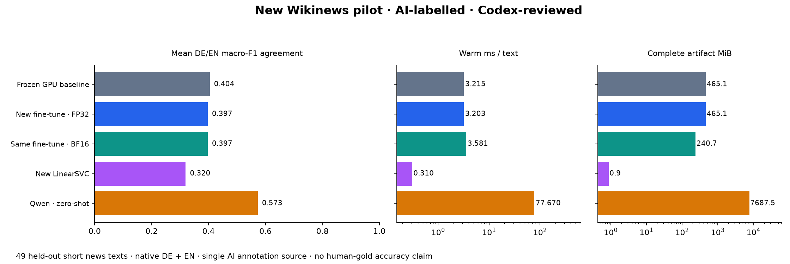

# New Wikinews pilot — AI-labelled · Codex-reviewed

This is a separate feasibility experiment, not a replacement for the historical human-labelled English benchmark. All figures measure agreement with one assistant’s reference annotations.

| Model | Mean DE/EN F1 | DE F1 | EN F1 | Positive F1 | ms/text | MiB |
|---|---:|---:|---:|---:|---:|---:|
| Frozen MiniLM · AI news pilot | 0.4042 | 0.4247 | 0.3837 | 0.0000 | 3.215 | 465.14 |
| MiniLM FP32 · v1 recipe / new AI data | 0.3970 | 0.3957 | 0.3983 | 0.0000 | 3.203 | 465.14 |
| MiniLM BF16 · v2 deployment / new AI data | 0.3970 | 0.3957 | 0.3983 | 0.0000 | 3.581 | 240.73 |
| LinearSVC · new AI news data | 0.3197 | 0.2342 | 0.4051 | 0.0000 | 0.310 | 0.87 |
| Qwen3 4B · unchanged zero-shot | 0.5728 | 0.6271 | 0.5185 | 0.1429 | 77.670 | 7687.49 |

Qwen remains the default: it leads this pilot and the earlier independent human-labelled English comparison. The new fine-tune did not outperform the frozen baseline here. All four fitted classifiers have zero positive-class F1 on the ten positive test examples; Qwen’s positive F1 is also weak. These results do not establish an improvement over the old versions.

The FP32 and BF16 conditions use the same newly trained weights. BF16 reduces size but is slightly slower in this single short measurement. It is not a second independent fit.

244 Train / 49 Val / 49 Test; Val unused. The test has 24 DE and 25 EN items, with only 4 DE and 6 EN positives. All candidates use the exact same test texts and AI labels. There are no machine translations. Short inputs, small sample size, one AI annotator, residual event overlap and unknown pretraining contamination limit conclusions. Do not compare these scores numerically with 0.720 or earlier benchmark figures.

Exploratory paired group bootstrap of saved predictions: 1,000 resamples, seed20261107, 95% percentile intervals in comparison.json. These intervals cover sampling variability, not AI annotation mistakes. No extra model evaluation was performed.

[Frozen protocol](protocol.json) · [AI labels and short rationales](annotations.csv) · [split and source hashes](split_manifest.json) · [source credits](source_manifest.json) · [CSV](comparison.csv) · [run IDs and confusion matrices](comparison.json)

