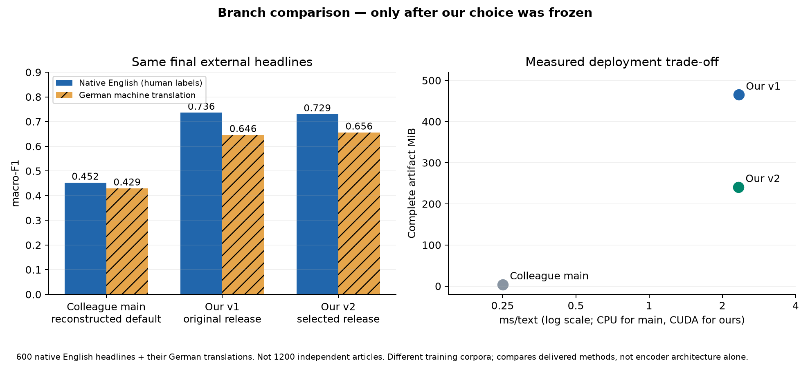

# Abschließender Vergleich mit dem anderen Branch

**Erst nach Abschluss der Ablationen, Auswahl und vollständigem Release-Training ausgeführt.** Die externe Bewertung änderte weder Auswahl noch Modelle.

| Lösung | macro-F1 EN nativ | macro-F1 DE übersetzt | macro-F1 gemeinsam (sekundär) | ms/Text | MiB |
| --- | ---: | ---: | ---: | ---: | ---: |
| colleague_main_default | 0.4524 | 0.4293 | 0.4410 | 0.250 | 4.08 |
| second_path_v1 | 0.7360 | 0.6458 | 0.6909 | 2.335 | 465.14 |
| second_path_v2 | 0.7293 | 0.6557 | 0.6925 | 2.326 | 240.73 |



Auf den 600 nativen englischen Headlines liegt v2 um +0.2770 macro-F1 vor dem rekonstruierten Kollegen-Standard. Ein gepaarter Bootstrap über diese 600 bereits vorhergesagten Headlines (1000 Ziehungen, Seed 20261019) ergibt ein 95-%-Perzentilintervall der Differenz [0.2257, 0.3249]. Keine zusätzlichen Modellvorhersagen oder Modellwahl durch Bootstrap.

**Kein pauschaler Genauigkeitsgewinn von v2 gegenüber v1 behauptet:** Englisch bewegt sich von 0.7360 auf 0.7293; übersetztes Deutsch von 0.6458 auf 0.6557. Die Artefaktgröße bewegt sich von 465.1 auf 240.7 MiB. Der Unterschied Englisch v1/v2 wird hier nicht als signifikant bezeichnet.

Der Kollegen-Standard ist erheblich kleiner und schneller auf CPU. Unser Encoder nutzt CUDA und ist trotz BF16 größer und langsamer. Für das vorgegebene Qualitätsziel spricht dieser externe Benchmark für den Encoder; für enge CPU-/Speicherbudgets bleibt LinearSVC ein klarer Trade-off. Das ist keine allgemeine Rangliste für andere Nachrichtendomänen.

## Herkunft, Filter, Grenzen

[SEntFiN](https://github.com/pyRis/SEntFiN), Revision `eba43610fe3cb57a3e5773cd6c037da1f8992ad5`, ursprüngliches Repo unter [MIT](https://github.com/pyRis/SEntFiN/blob/eba43610fe3cb57a3e5773cd6c037da1f8992ad5/LICENSE); Sinha, Kedas, Kumar, Malo. Von 10.753 englischen Headlines bleiben 9.512 mit einem einheitlichen Sentiment für sämtliche genannten Entitäten und gültiger Länge. Nach normalisierten Duplikaten und Prüfung gegen beide Trainingskorpora bleiben 9.453; kein exakter normalisierter Trainingsüberlapp wurde gefunden. Je 200 negative, neutrale und positive Headlines werden ohne Modellvorhersagen mit Seed 20261019 gezogen.

Die englischen Labels stammen aus der menschlichen Entitätsannotation. Das Übertragen auf den ganzen Titel erfolgt nur bei einstimmigen Entitätslabels; das bleibt eine Operationalisierung, keine neue Annotation. Die 600 deutschen Texte werden aus genau diesen Titeln mit [Helsinki-NLP/opus-mt-en-de](https://huggingface.co/Helsinki-NLP/opus-mt-en-de), CC-BY-4.0, Revision `6183067f769a302e3861815543b9f312c71b0ca4` übersetzt (Beam 4, kein Sampling, Kontext 256, max. 128 neue Token). Kein englischer Quelltext wurde durch den Kontext gekürzt. Deutsche Labels sind übernommen: Übersetzungsfehler und eine veränderte Tonalität wurden nicht unabhängig geprüft. **DE ist deshalb ein MT-Transfercheck, kein nativer deutscher Goldtest.**

Der Benchmark ist klassenbalanciert, besteht aus Headlines und hat 600 unterschiedliche Titelpaare. Er repräsentiert weder natürliche Nachrichtenhäufigkeiten noch vollständig gelabelte Artikel. Semantischer Ereignisüberlapp und Vortrainingskontamination sind unbekannt. Die alte Testzahl 0,720 und die alte eigene Zahl 0,7187 werden nicht zur Rangbildung benutzt.

## Unveränderte Referenz, kein nachgetragener Lauf auf main

Der Referenzcode liegt ausschließlich in einem separaten detached Checkout auf `a840bb7bc8f1656f1700ccabaa89837ce347ca2b`. Der Adapter importiert `new_linearsvc` und die originale `prepare()`-Funktion. Er kopiert keine Modellimplementierung in second-path und ruft niemals `src.train` oder das ursprüngliche MLflow-Experiment auf. Referenz-Trainingsdaten: 5.923 Zeilen aus Phrasebank EN und Kenpache DE; pandas 3.0.6, scikit-learn 1.9.1 und joblib 1.6.0 wie in deren Requirements. Unsere Modelle trainieren auf 8.335 Kenpache-DE/EN-Zeilen. Der Vergleich trennt daher nicht den Effekt der Architektur von der Trainingsdatenwahl.

Die ursprünglichen trainierten Gewichte des Kollegen waren nicht verfügbar. Das Ergebnis ist eine Rekonstruktion des gelieferten Standardverfahrens mit unverändertem Code und erneut hergestelltem Trainingssplit; es wird weder Bitgleichheit zum damaligen Artefakt noch zum damaligen Testsplit behauptet. Code-, Daten- und Artefakthashes stehen in `peer_provenance.json`, die Referenz-Abhängigkeiten in `reference_requirements.txt`.

Alle drei neuen gemeinsamen Auswertungen liegen ausschließlich im Experiment `article-sentiment-second-path`, Tag `phase=final-branch-comparison`. Die Hauptbranch-Referenz und ihr MLflow-Verzeichnis bleiben unverändert.

## Entscheidungen nach Themen

| Thema | Beobachtung / Entscheidung |
| --- | --- |
| Qualität der Evidenz | Quellengetrennte Train-CV und zusätzlicher externer Audit statt eines weiteren Blicks auf den alten Test. Kein Beleg für allgemeine Artikelqualität. |
| Trainingsgewichtung | Sprache×Klasse verändert die CV-Werte nur gering; kein belastbarer großer Genauigkeitsgewinn. |
| Artikelverarbeitung | R2/R4 bestehen sechs statt zwei HTML-Fixtures; technische Verbesserung, kein menschlich gelabelter Artikelnachweis. Nicht Bestandteil des nach Zeit-Tie-Regel gewählten R3-Standards. |
| Betrieb | R3/BF16 liefert ca. 241 statt 465 MiB; begrenztes Warten und Prüfung endlicher Scores verhindern zwei konkrete Betriebsfehler. Geringe Latenzunterschiede sind keine Signifikanzbehauptung. |
| Kombination / Auswahl | Höchster CV-Punktwert: R4_combined mit 0.6740. Gewählt nach der vorab erklärten Nähe-/Latenzregel: R3_deploy mit 0.6729 und 2.381 ms. Kein nachträgliches Umdefinieren, um alles kombiniert auszuliefern. |
| Kollege vs. second-path | Auf diesem gemeinsamen nativen EN-Benchmark bessere Encoder-Qualität gegen deutlich kleineren/schnelleren CPU-Standard. Andere Daten, Kosten und Sprachdomänen können die Entscheidung ändern. |

## Frisch reproduzieren (erst nach v2-Auswahl)

In einem frischen Clone nach den v2-Befehlen im README. Der v1-Trainingsaufruf erzeugt nur den Vergleichsstand, keine alte Testbewertung. Auf dem aktuellen Tower sind die Artefakte bereits vorhanden und werden nicht überschrieben. Neue Berichte bleiben von den historischen getrennt.

```bash
export SENTIMENT_DEV_REPORTS=reports/reproduction
python -m pip install -r requirements-evaluation.txt
python -m src.train finetuned
git clone --no-checkout https://github.com/Rasvan-Teofil/ai-operations-projekt.git ../colleague-reference
git -C ../colleague-reference checkout --detach a840bb7bc8f1656f1700ccabaa89837ce347ca2b
python3.12 -m venv ../colleague-reference/.venv
../colleague-reference/.venv/bin/python -m pip install -r reports/development/reference_requirements.txt
../colleague-reference/.venv/bin/python src/peer_reference.py prepare --checkout ../colleague-reference --report reports/reproduction/peer_provenance.json
python -m src.branch_benchmark prepare
python -m src.branch_benchmark audit
python -m src.development_report
```

Referenzdaten werden durch den Adapter auf die protokollierten HF-Snapshots gepinnt; die originale Filter-/Split-/Modellimplementierung bleibt unangetastet. Der Benchmark besitzt eine exklusive lokale Audit-Sperre. Originale Test-/Val-Dateien werden von unserer Entwicklung nicht als Bewertungsdaten verwendet.
