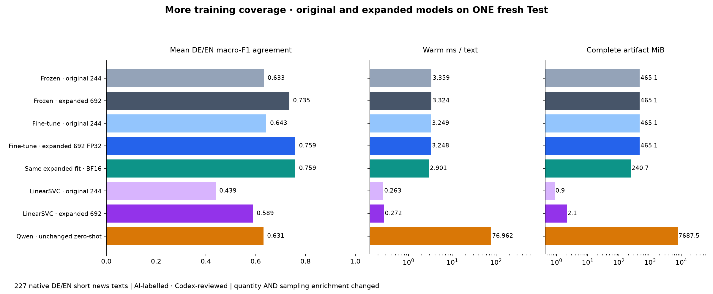
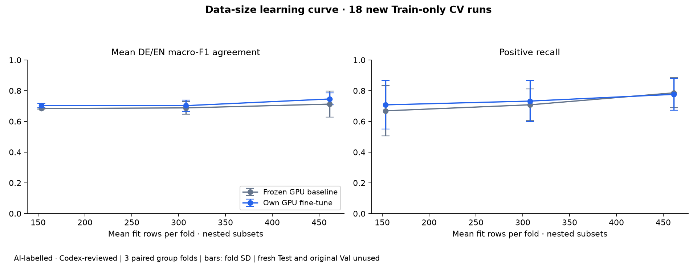

# Expanded news data — AI-labelled · Codex-reviewed

The new collection adds 448 accepted training examples to the original 244:692 Train, including 206 positives instead of 45. A fresh 227-item random Test is shared by all eight conditions. The original 49 Val and49 Test remain outside fitting; the old Test is not evaluated again.

| Condition | Mean DE/EN F1 | DE F1 | EN F1 | Positive F1 | Positive recall | ms/text | MiB |
|---|---:|---:|---:|---:|---:|---:|---:|
| Original 244 · frozen baseline | 0.6330 | 0.6060 | 0.6599 | 0.4598 | 0.4444 | 3.359 | 465.14 |
| Expanded frozen GPU baseline | 0.7350 | 0.6534 | 0.8165 | 0.6118 | 0.5778 | 3.324 | 465.14 |
| Original 244 · own fine-tune FP32 | 0.6428 | 0.6410 | 0.6446 | 0.4810 | 0.4222 | 3.249 | 465.14 |
| Expanded own fine-tune · FP32 | 0.7591 | 0.7128 | 0.8054 | 0.6437 | 0.6222 | 3.248 | 465.14 |
| Same expanded fine-tune · BF16 | 0.7591 | 0.7128 | 0.8054 | 0.6437 | 0.6222 | 2.901 | 240.73 |
| Original 244 · LinearSVC | 0.4390 | 0.3843 | 0.4936 | 0.2642 | 0.1556 | 0.263 | 0.87 |
| Expanded LinearSVC | 0.5891 | 0.5455 | 0.6328 | 0.5476 | 0.5111 | 0.272 | 2.14 |
| Unchanged Qwen3 4B · zero-shot | 0.6311 | 0.6132 | 0.6490 | 0.4000 | 0.2889 | 76.962 | 7687.49 |

## Paired data changes on the same fresh Test

- frozen_news_v4: mean-language F1 change +0.1020, exploratory paired 95% interval [+0.0410, +0.1691]; positive recall change +0.1333.
- minilm_fp32_news_v4: mean-language F1 change +0.1162, exploratory paired 95% interval [+0.0538, +0.1827]; positive recall change +0.2000.
- linearsvc_news_v4: mean-language F1 change +0.1502, exploratory paired 95% interval [+0.0725, +0.2282]; positive recall change +0.3556.

These measure quantity plus changed class/topic coverage, not a causal effect of quantity alone. All agreements use one assistant’s reference labels, not a human annotator panel. The larger Test has 111 DE and 116 EN items, with 26 DE and 19 EN positives. Label/source exclusions preceded fitting. Inputs are historical title+lead excerpts; long-article, sentence-highlight and real newsroom performance remain unmeasured. Unknown pretraining/event overlap and annotation errors remain possible.

Descriptive leader under the frozen mean-language F1 /0.005 latency-size rule: **minilm_bf16_news_v4**. This AI-only study does not automatically change the Qwen serving default established by the earlier human-labelled English comparison. New expanded models are experimental selectable choices. The BF16 artifact is a storage/serving derivation of the same full-Train fit, not another independent training fit.

## Train-only learning curve

| Model | Mean fit rows | Mean DE/EN F1 ± fold SD | Positive recall ± fold SD |
|---|---:|---:|---:|
| frozen_news_v4 | 153.7 | 0.6841 ± 0.0037 | 0.6690 ± 0.1632 |
| frozen_news_v4 | 307.7 | 0.6880 ± 0.0416 | 0.7082 ± 0.1043 |
| frozen_news_v4 | 461.3 | 0.7128 ± 0.0854 | 0.7862 ± 0.0975 |
| minilm_fp32_news_v4 | 153.7 | 0.7036 ± 0.0132 | 0.7079 ± 0.1572 |
| minilm_fp32_news_v4 | 307.7 | 0.7027 ± 0.0360 | 0.7324 ± 0.1335 |
| minilm_fp32_news_v4 | 461.3 | 0.7461 ± 0.0389 | 0.7762 ± 0.1040 |

Three fixed StratifiedGroupKFold folds inside expanded Train. Each fold has nested 1/3, 2/3, full fit-group subsets and the same development set for all sizes. Eighteen real MLflow runs compare the clean frozen GPU baseline and own GPU fine-tune. SD is variation across three folds, not a confidence interval. Final three-epoch recipe was frozen before CV; no candidate search or Val/Test selection. Larger subsets also mean more optimizer steps at a fixed epoch count. This curve uses development sets; its values are not joined to historic Test scores.

All 26 new runs are in `article-sentiment-second-path`, phase=`wikinews-ai-v4-expanded`, stage=`cv` (18) or `final-test` (8). Required parameters, accuracy, macro/per-class F1, latency, full artifact size, and confusion matrices are logged. Old controls receive new evaluation runs; historical run metrics remain unchanged.

[Frozen protocol](protocol.json) · [New annotation ledger](annotations.csv) · [Source credits](source_manifest.json) · [Split and input hashes](split_manifest.json) · [CV membership](cv_membership.json) · [CV run IDs](cv.json) · [Final metrics, intervals and run IDs](comparison.json)

