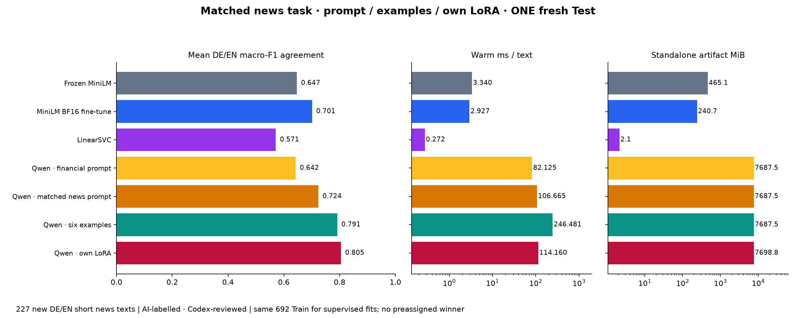
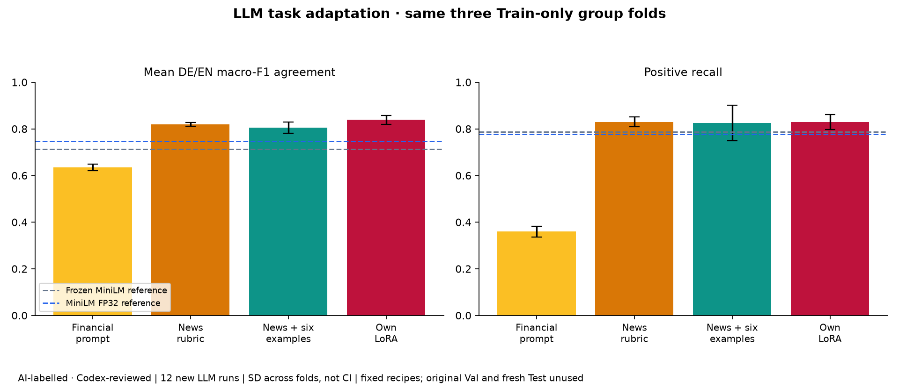

# Matched-task LLM adaptation — AI-labelled · Codex-reviewed

The previous data-expansion experiment compared a task-trained classifier with unchanged financial-domain zero-shot Qwen on broad news. It fairly measured the value of new training coverage, but did not establish a general architecture ranking. This follow-up tests the suspected task/adaptation mismatch without assigning a winner in advance.

**Same 692 Train inputs and labels as v4; no new Train data.** Qwen conditions: original financial prompt, fixed general-news rubric, same rubric with six seeded Train-only demonstrations, and an own rank 8 LoRA adaptation. Small-model frozen baseline, BF16 fine-tune and LinearSVC remain unchanged controls. LoRA has 2,949,120 trainable parameters, a frozen BF16 base and FP32 adapters/Adam states; three full epochs, microbatch 1 / accumulation 16, LR 1e-4, no quantization or truncation. It learns conditional A/B/C next-token classification, not free-text generation. The discarded Train-only memory probe fit the longest input (533 tokens) in 8.34 GB allocated; no accuracy claim comes from it.

**Different fresh Test: 227 inputs, exact SHA-256 `723673ee3c08fb7c2896aed0e14396623de25d9959f5c68382a4eb7971f48b93`.** Random 120/language before labels from the same recent 1500 page pool; all 1080 historical Wikinews inputs and linked/source/near-duplicate groups excluded. 239 raw inputs, 12 annotation exclusions, 227 retained: 132 negative / 58 neutral / 37 positive; DE 109, EN 118. These are not the previous v4 Test despite the coincidentally equal 227 count. No class-hint enrichment or balancing on Test. One AI annotator created/reviewed exact-input labels before candidate results. Exact assistant serving revision is unavailable. Old Val/Test files are not used to fit or select examples, and no old Test or run metrics are rescored/overwritten.

| Condition | Mean DE/EN F1 | DE | EN | Positive recall | ms/text | Standalone MiB |
|---|---:|---:|---:|---:|---:|---:|
| Frozen MiniLM · 692 Train | 0.6467 | 0.6117 | 0.6817 | 64.9% | 3.340 | 465.14 |
| MiniLM BF16 · 692 Train | 0.7012 | 0.6832 | 0.7192 | 67.6% | 2.927 | 240.73 |
| LinearSVC · 692 Train | 0.5710 | 0.5957 | 0.5463 | 51.4% | 0.272 | 2.14 |
| Qwen · original financial prompt | 0.6422 | 0.6690 | 0.6153 | 29.7% | 82.125 | 7687.49 |
| Qwen · news rubric zero-shot | 0.7235 | 0.7465 | 0.7005 | 70.3% | 106.665 | 7687.49 |
| Qwen · news rubric + six examples | 0.7914 | 0.7656 | 0.8172 | 75.7% | 246.481 | 7687.50 |
| Qwen · own LoRA on same Train | 0.8049 | 0.8392 | 0.7705 | 70.3% | 114.160 | 7698.77 |

Descriptive leader under the frozen mean-language F1 rule (within 0.005: latency then size): **Qwen · own LoRA on same Train**. The result is agreement with one AI reference annotator, not human-gold accuracy or proof that an architecture is universally better. The benchmark serving default remains the historical Qwen selection under the predeclared AI-only policy; new profiles are experimental website choices.

LoRA minus Few-Shot is +0.0134 F1, with 114.160 versus 246.481 ms/text. This is a descriptive point ordering, not a claim of statistically established superiority for that pair. LoRA catches 123/132 negatives versus 119/132, but only 26/37 positives versus 28/37. The fixed macro-F1 criterion does not imply improvement for every class.

Few-Shot is below the news prompt in two development folds but above it on this fresh Test. The conditions were retained before either result; this reversal is not used to revise examples, labels or training. CV means and fresh-Test scores measure different samples and must not be joined as a single numerical progress curve.

## Paired changes

- qwen3_4b → qwen_news_v5: +0.0814, exploratory paired 95% interval [+0.0022, +0.1581].
- qwen_news_v5 → qwen_fewshot_v5: +0.0679, exploratory paired 95% interval [+0.0200, +0.1155].
- qwen_news_v5 → qwen_lora_v5: +0.0813, exploratory paired 95% interval [+0.0262, +0.1379].
- minilm_bf16_news_v4 → qwen_lora_v5: +0.1037, exploratory paired 95% interval [+0.0321, +0.1784].

Intervals use 1,000 source-group bootstrap resamples of saved predictions, seed 20261109; no repeated model inference. They cover sampling variability, not systematic annotation error, and are not adjusted for multiple comparisons.

## Train-only development

| Qwen condition | Mean F1 ± fold SD | Positive recall ± fold SD |
|---|---:|---:|
| Qwen · original financial prompt | 0.6338 ± 0.0140 | 0.3593 ± 0.0229 |
| Qwen · news rubric zero-shot | 0.8190 ± 0.0079 | 0.8302 ± 0.0210 |
| Qwen · news rubric + six examples | 0.8055 ± 0.0241 | 0.8254 ± 0.0763 |
| Qwen · own LoRA on same Train | 0.8387 ± 0.0194 | 0.8299 ± 0.0318 |

Three unchanged v4 full-size source-group folds within Train, four Qwen conditions/fold=12 new CV runs. Six examples are sampled independently from that fold’s fit rows (one/language/class), never from dev. The old small-model FP32 full-fold scores are reused with their original run IDs and clearly marked as references; they are not new runs or new BF16 measurements. All recipes were fixed before CV: no prompt sweep, epoch choice or hyperparameter search. The full-Train LoRA subsequently uses all 692 inputs each epoch. All seven conditions are frozen before the final fresh-Test audit, once per text/condition with exclusive completion lock and interruption checkpoints.

## Cost and serving

Full standalone size includes the shared Qwen base plus each profile/adapter. Incremental on-disk size is separately in CSV/JSON; it is not presented as a tiny standalone LLM. Prompt/Few-Shot update no weights, but have preprocessing and inference cost. Few-shot context overhead is included in measured batch-one latency. All methods exclude pretraining cost; controls retain historical fit costs rather than pretending they were free.

| Condition | Additional/historical fit seconds | Cost scope |
|---|---:|---|
| Frozen MiniLM · 692 Train | 1.63 | Historical original fit |
| MiniLM BF16 · 692 Train | 4.86 | Historical original fit |
| LinearSVC · 692 Train | 0.17 | Historical original fit |
| Qwen · original financial prompt | 0.00 | No new weight training; pretraining cost excluded |
| Qwen · news rubric zero-shot | 0.00 | No new weight training; pretraining cost excluded |
| Qwen · news rubric + six examples | 0.00 | No new weight training; pretraining cost excluded |
| Qwen · own LoRA on same Train | 670.77 | New adapter fit |

One isolated RTX 5060 Ti benchmark worker; API paused, 4 CPU threads, 20 separate synthetic warmups, synchronized batch 1 timing including tokenization/transfers but excluding loading/network. The API shares one local Qwen base across prompts and the adapter. Adapter state is serialized; unadapted requests explicitly disable the adapter. Offline unit checks and synthetic before/after regression controls verify routing/state isolation; no held-out test is reused for API testing.

## Interpretation and limits

This gives the LLM the same task definition and access to the same training labels, including its own supervised adaptation. It does not equalize parameter counts, optimizer settings, total updates, context length or compute. Small-model Train truncation/chunk inference and LLM context policies differ and remain disclosed. A larger LLM can help but cannot be declared the winner by design. Single-AI labels, short historical source leads, unknown pretraining/event overlap and small positive-class language cells limit conclusions. Source licensing is retained; data/weights/demo texts remain outside Git.

All 19 new scored runs use `article-sentiment-second-path`, phase=`wikinews-llm-adaptation-v5`, stage=`cv` (12) or `final-test` (7). Accuracy, macro/per-class F1, recalls, language metrics, latency, standalone size, confusion matrices, hashes and runtime/Git parameters are logged. The memory probe is engineering evidence, not an unscored model-accuracy run.

[Frozen protocol and exact prompt](protocol.json) · [AI labels/rationales](annotations.csv) · [Source credits](source_manifest.json) · [Split](split_manifest.json) · [CV example/membership audit](cv_membership.json) · [CV run IDs](cv.json) · [Frozen artifact/dependency hashes](trained.json) · [Final metrics and intervals](comparison.json)

Implementation sources: [official Qwen model card](https://huggingface.co/Qwen/Qwen3-4B-Instruct-2507), [PEFT LoRA documentation](https://huggingface.co/docs/peft/v0.18.0/en/package_reference/lora), [PEFT precision/adapter guidance](https://huggingface.co/docs/peft/v0.18.0/en/developer_guides/troubleshooting). These document the method; project measurements above are from actual local runs.

