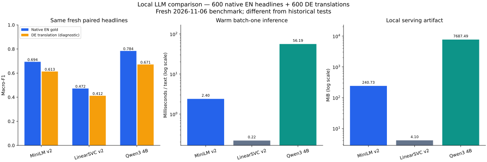

# Local LLM comparison (measured)

Primary selection: native English macro-F1; close margin 0.005, then latency and artifact size.

| Model | EN macro-F1 | DE-MT macro-F1 | Pooled accuracy | ms/text | MiB | MLflow run |
|---|---:|---:|---:|---:|---:|---|
| MiniLM v2 (fine-tuned) | 0.6936 | 0.6132 | 0.6533 | 2.398 | 240.73 | `e2ab0f5273b54fd9b7c2f81a751f4b6c` |
| LinearSVC v2 (reconstructed) | 0.4720 | 0.4119 | 0.4617 | 0.218 | 4.10 | `a3859fbfd0b041e5aedf7e28d0f85532` |
| Qwen3 4B (local, zero-shot) | 0.7839 | 0.6715 | 0.7317 | 56.190 | 7687.49 | `6c07d33fa4804e9591305999917e34a6` |

Selected: **Qwen3 4B (local, zero-shot)**.

The German texts are machine translations with inherited labels, not native German gold. These are 600 independent paired headlines, not 1,200 independent articles. No prompt/model settings were changed using this benchmark. Public pretraining contamination and semantic overlap remain unknown.

The LinearSVC is reconstructed from the pinned current-main v2 recipe, not the original supplied weights. See `reference_provenance.json` for source, dataset, supplement and environment hashes. Its old financial-test score 0.7330 and our earlier tests are not ranked against this benchmark.

