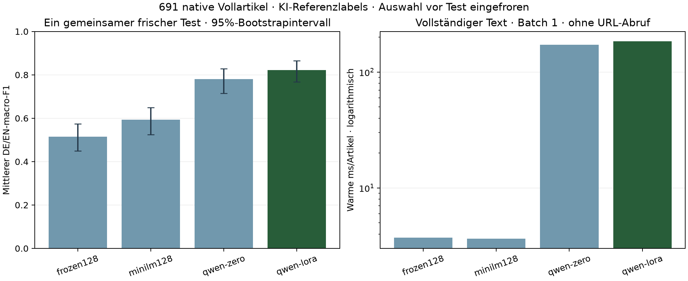

# Vollartikel: gemeinsamer frischer Abschlusstest

691 Testartikel aus 856 vorab erhobenen Quellenfällen. Alle lernenden Kandidaten sehen dieselben 240 Train-Artikel. Ausgewählt vor der Testbewertung: **qwen-lora**. Kein Nachoptimieren am Test.

**AI-labelled · Codex-reviewed**: zwei Durchgänge desselben KI-Annotators. Die Referenzlabels sind keine unabhängig bestätigte Human-Ground-Truth.

| Kandidat | DE/EN-macro-F1 | 95%-Intervall | DE | EN | JA | warme ms/Artikel | vollständige MiB |
|---|---:|---|---:|---:|---:|---:|---:|
| frozen128 | 0.5150 | [0.4499, 0.5740] | 0.5281 | 0.5019 | 0.6257 | 3.721 | 240.73 |
| minilm128 | 0.5928 | [0.5240, 0.6486] | 0.4734 | 0.7122 | 0.5655 | 3.659 | 240.73 |
| qwen-zero | 0.7796 | [0.7154, 0.8289] | 0.7508 | 0.8085 | 0.8143 | 172.330 | 7687.49 |
| qwen-lora | 0.8218 | [0.7672, 0.8658] | 0.7612 | 0.8825 | 0.8132 | 184.258 | 7698.77 |

## Reichweite

Einmalige erfolgreiche Inferenz pro Testartikel und Kandidat; Aufwärmen ausschließlich mit Train-Texten. Latenz enthält Tokenisierung, Transfer, Kontext und Aggregation. Laden und URL-Abruf sind getrennt. Qwen-Größe enthält Basisgewichte und Adapter. Trainingszeit und Speicher stehen mit Laufkennungen, Klassenwerten und Konfusionsmatrizen im JSON/CSV.

Die Bootstrapintervalle verwenden gemeinsam gezogene vollständige beobachtete Ereignis-/Quellengruppen. Sie beschreiben Stichprobenunsicherheit bedingt auf diese KI-Referenzen; sie erfassen weder deren systematische Fehler noch unbekannte Vortrainingsüberschneidungen. Die kleine Train-Mengenkurve zeigte keine Sättigung; 240 ist kein belegtes Datenoptimum.

Die Population ist ein vorab eingeschränktes Archiv: native Artikel, begrenzte direkte Zitate, maximal 20000 Zeichen und 4096 Qwen-Artikeltokens. Offene Dritttextrechte, unauflösbare Labels und geschützte Ereignisverbindungen bleiben mit Ausschlussgrund erhalten. Die erste Auswahl bis zur Sprachquote verwendet Quellenreihenfolge und ganze Gruppen, keine nachträgliche Klassenbalance oder Modellfehler.

Alle früheren Vergleichsgruppen bleiben eigenständig. Diese Zahlen werden weder mit v1–v5 zu einer Fortschrittskurve verbunden noch als 95%-Qualitätsgarantie ausgegeben. Scores sind nicht kalibriert. Satzfarben in der Anwendung sind zusätzliche Vorhersagen und keine kausalen Worterklärungen.

Referenz-Mehrdeutigkeit und Fehlerfälle werden aus denselben gespeicherten Vorhersagen beschrieben. Labels und Kandidaten bleiben dabei unverändert.

## Dateien

- `comparison-v1.json`: vollständige Ergebnisse, Laufkennungen, Kosten und Konfusionsmatrizen je Sprache.
- `final-test-v1/test-manifest.json`: exakte Hashes, Mitgliedschaft, Klassen, Quellenverluste und Schutzdateien.
- `final-test-uncertainty-v1.json`: gepaarte Gruppen-Bootstrapintervalle.
- `final-test-reference-sensitivity-v1.json`: Auswertung eindeutiger Referenzfälle ohne neue Inferenz.
- `error-analysis-v1.json`: unveränderte Referenzen, Bezugsgegenstände und Kandidatenfehler ohne Rohtextveröffentlichung.
