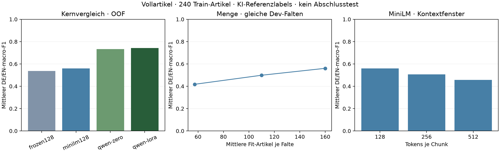

# Vollartikel: Entwicklung innerhalb Train

240 Artikel (78 DE, 71 EN, 91 JA), drei gruppierte Falten. Primärwert: Mittel von DE- und EN-macro-F1 aus den zusammengesetzten Out-of-fold-Vorhersagen; jede Train-Zeile wird je Bedingung genau einmal außerhalb ihres Fit-Teils bewertet. Kein frischer Abschlusstest in diesem Bericht.

**AI-labelled · Codex-reviewed**: ein KI-Annotator mit Eigenprüfung; keine unabhängig geprüften Humanlabels.

| Bedingung | DE/EN-macro-F1 | DE | EN | JA | Falten-SD des Primärwerts | warme ms/Artikel |
|---|---:|---:|---:|---:|---:|---:|
| frozen128 | 0.5364 | 0.5285 | 0.5444 | 0.5759 | 0.0087 | 3.321 |
| minilm128 | 0.5606 | 0.5740 | 0.5473 | 0.5939 | 0.1028 | 3.363 |
| qwen-zero | 0.7321 | 0.6721 | 0.7921 | 0.7950 | 0.0761 | 164.531 |
| qwen-lora | 0.7432 | 0.7227 | 0.7637 | 0.7922 | 0.0315 | 174.686 |
| minilm-third | 0.4176 | 0.4212 | 0.4141 | 0.4185 | 0.0164 | 3.478 |
| minilm-two-thirds | 0.4987 | 0.5204 | 0.4770 | 0.5338 | 0.0689 | 3.355 |
| minilm256 | 0.5066 | 0.4901 | 0.5230 | 0.4954 | 0.0954 | 3.348 |
| minilm512 | 0.4565 | 0.5104 | 0.4026 | 0.5748 | 0.0639 | 3.403 |

## Was diese Messung zeigt

- Die größere MiniLM-Trainmenge verbessert den OOF-Primärwert in dieser festen Rezeptur. Die Kurve zeigt noch keine Sättigung. 240 ist der vollständige geeignete Pilotbestand und kein belegtes Optimum oder Nachweis ausreichender Produktionsdaten.
- Die Mengenbedingungen verwenden im Mittel etwa 57, 110 und 160 Fit-Artikel je Falte auf identischen Dev-Teilen. Die finale vollständige Train-Menge ist 240. Tokenzahlen und Optimiererschritte sind in den zugehörigen Läufen gespeichert.
- Ein größeres MiniLM-Fenster verbessert den Primärwert hier nicht. Andere Daten, Rezepte oder ausreichend lange Texte könnten anders ausfallen; eine allgemeine Aussage über Kontextlänge folgt daraus nicht.
- Qwen LoRA und Qwen ohne Anpassung liegen nahe beieinander. Der kleine Abstand beweist keine statistisch gesicherte Überlegenheit. Die vorab festgelegte optionale Seed-Prüfung wird getrennt protokolliert.
- Alle Aussagen gelten für eine einzelne, vorab eingeschränkte Wikinews-Population. Insbesondere umfangreiche Drittzitate und Interviews fehlen häufig nach der Rechteprüfung. Unbekannte Vortrainingsüberschneidungen bleiben möglich.

## Schutz der Vergleichsgruppen

Frühere Val-/Test-Dateien und konservativ alle alten Wikinews-Sammlungen sind geschützt. Sprachfassungen, Ursprungsquellen und geprüfte Ereignisreihen werden transitiv verbunden. Zusätzliche FIFA- und Noto-Ereignisaliase lagen bereits vollständig in jeweils derselben bestehenden Falte; Text, Label und Mitgliedschaft wurden nicht geändert. Das Verfahren garantiert keine vollständige semantische Duplikaterkennung.

Falten-SD ist kein Konfidenzintervall. Latenzen umfassen Tokenisierung, Transfer, vollständigen Kontext und Aggregation; Laden und URL-Abruf sind ausgeschlossen. Die Referenzlabels und eine mögliche KI-Fehlerkorrelation begrenzen jede Qualitätsinterpretation.

24 Entwicklungsauswertungen: 12 Kernbedingungen, 6 Mengenbedingungen und 6 Kontextbedingungen. Technische Kapazitätsprüfungen, optionale Seed-Prüfung und spätere vollständige Train-Fits werden separat gezählt.

