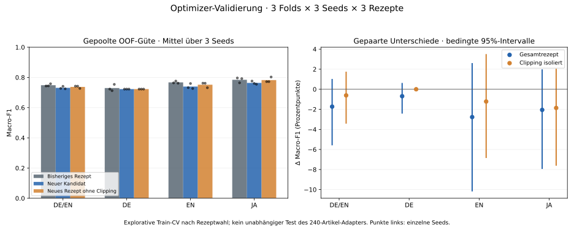

# Optimizer-Validierung: Ergebnis und Modellentscheidung

**Nachfolgende Clipping-Kontrolle abgeschlossen:** Die [vollständigen Gegenläufe](../clipping_control/README.md) ergänzen die sieben früher fehlenden Ohne-Clipping-Fits des bisherigen Rezepts. Beide Rezepte sind jetzt jeweils über drei Folds und drei Seeds isoliert mit/ohne Clipping verglichen: bisheriges Rezept +0,32 F1-Prozentpunkte [−2,13; +2,61], neues Rezept −0,61 [−3,43; +1,75] im mittleren DE/EN-Hauptwert, jeweils mit minus ohne Clipping. Kein robuster positiver Nachweis. Die folgenden ursprünglichen 27 Ergebnisse bleiben erhalten und beschreiben den damaligen Vergleichsumfang.

Ein positiver Clipping-Effekt ist in dieser erweiterten Prüfung nicht belegt.
Das neue Gesamtrezept zeigt keinen belegten Vorteil; der bisherige API-Standard bleibt die Empfehlung.

**27/27 Auswertungen abgeschlossen: 21 neue Fits und sechs exakt übernommene bestehende Fits.** Drei gruppierte Folds, drei feste Seeds, 240 Train-Artikel in 235 semantischen Gruppen. Kein erneuter Abschlusstest, kein automatischer Modellwechsel.

Der mittlere DE/EN-OOF-Wert beträgt 0.7483 für das bisherige Rezept und 0.7310 für den neuen Kandidaten: Unterschied -1.73 F1-Prozentpunkte. Clipping allein im neuen Rezept ergibt -0.61 Punkte gegenüber ohne Clipping. Die Unsicherheitsintervalle und einzelnen Seeds stehen unten.

Der frühere mittlere Clipping-Vorteil von +1,75 Punkten stammt aus einem einzigen Fold und mittelt über mehrere andere Parametereinstellungen. Die jetzige Kontrolle untersucht Clipping bei der konkret ausgewählten neuen Rezeptur über weitere Folds und einen zusätzlichen Seed. Die Befunde betreffen unterschiedliche Vergleichsbereiche; ein allgemeiner Clipping-Vorteil lässt sich daraus nicht ableiten.

**Was verglichen wurde:** Bisheriges Rezept und neuer Kandidat verwenden beide Clipping 1,0. Ihr Unterschied betrifft Lernrate, Weight Decay und Warmup. Der Vergleich des neuen Rezepts mit und ohne Clipping isoliert den Clipping-Schalter.

## Gepoolte Out-of-fold-Güte

Pro Seed und Rezept werden zunächst alle 240 zurückgehaltenen Vorhersagen aus den drei Folds gepoolt. Erst danach wird Macro-F1 berechnet. Die folgende Tabelle mittelt die drei festen Seed-Werte. Der DE/EN-Wert gewichtet beide Sprachen gleich.

| Rezept | DE/EN Macro-F1 | DE | EN | JA |
|---|---:|---:|---:|---:|
| Bisheriges Rezept | 0.7483 | 0.7296 | 0.7671 | 0.7842 |
| Neuer Kandidat | 0.7310 | 0.7227 | 0.7394 | 0.7636 |
| Neues Rezept ohne Clipping | 0.7371 | 0.7227 | 0.7516 | 0.7822 |

## Gepaarte Unterschiede

Absolute F1-Prozentpunkte; positive Werte sprechen für den neuen Kandidaten. Intervalle sind bedingte 95%-Gruppen-Bootstrap-Intervalle mit 2000 festen Ziehungen, keine um Auswahlverzerrung bereinigten Bestätigungsintervalle.

| Vergleich | DE/EN Δ [Intervall] | DE Δ | EN Δ | JA Δ |
|---|---:|---:|---:|---:|
| Neues Gesamtrezept − bisheriges Rezept | -1.73 [-5.59; +1.03] | -0.69 | -2.77 | -2.06 |
| Neues Rezept mit − ohne Clipping | -0.61 [-3.43; +1.75] | +0.00 | -1.22 | -1.86 |

| Seed | Gesamtrezept Δ DE/EN (pp) | Clipping Δ DE/EN (pp) |
|---|---:|---:|
| 20261110 | -1.59 | -1.49 |
| 20261111 | -0.28 | -0.09 |
| 20261112 | -3.33 | -0.25 |

## Kontrolle außerhalb des Auswahlfolds

Fold 0 war bereits zur Rezeptwahl verwendet worden. Nur aus den übrigen Folds 1 und 2 gepoolt ergeben sich folgende Seed-gemittelten Unterschiede. Auch diese wiederverwendeten Train-Daten sind kein unabhängiger Abschlusstest.

| Vergleich | DE/EN Δ (pp) | DE Δ | EN Δ | JA Δ |
|---|---:|---:|---:|---:|
| Gesamtrezept | -3.42 | -1.43 | -5.40 | -2.01 |
| Clipping | -1.49 | +0.00 | -2.98 | -4.29 |

## Vorab festgelegte Entscheidung

| Regel für das neue Gesamtrezept | Erfüllt |
|---|---|
| Mindestens +1 pp im mittleren DE/EN-Wert | nein |
| Kein negativer DE/EN-Unterschied in einem der drei Seeds | nein |
| Keine Sprache verliert im Mittel mehr als 1 pp | nein |

Clipping-Unterstützung verlangt gleichzeitig einen positiven mittleren DE/EN-Unterschied, positive DE/EN-Unterschiede in allen drei Seeds und eine positive untere bedingte Bootstrap-Grenze. Ein Nichterfüllen ist kein Beweis für Wirkungslosigkeit, sondern ein nicht ausreichend robuster positiver Nachweis nach dieser Regel.

## Was das für das gespeicherte Modell bedeutet

Der bereits trainierte Adapter `article-qwen-lora-optimizer-v1` ist technisch funktionsfähig und bleibt optional über `article_qwen_lora_optimizer_v1` ausführbar. Seine Gewichte wurden durch diese Prüfung nicht verändert. Gemessen wurde die Trainingsrezeptur in 159/160/161-Artikel-Fits; die obigen F1-Werte sind keine direkt gemessene unabhängige Testgüte des auf allen 240 Artikeln trainierten Adapters.

Das Ergebnis ist auch keine Empfehlung, Clipping im bisherigen Standard pauschal abzuschalten: dessen Variante ohne Clipping wurde hier nicht über alle Folds geprüft. Die isolierte Clipping-Kontrolle gilt für das neue Rezept; das bestehende Gesamtrezept bleibt im CV-Punktwert vor beiden neuen Varianten.

Die ursprüngliche Auswahl und der frühere gemeinsame Test bleiben erhalten. Es gibt keinen nachträglichen Austausch der Testwerte. Ein unabhängiger Qualitätsnachweis für den Volltrain-Adapter erfordert eine gesondert geplante frische Evaluation.

## Was Clipping technisch beeinflusst

Alle Fits verwenden AdamW. Der frühere Faktorvergleich untersucht dessen Weight Decay, keinen Vergleich mit einer anderen Optimizerfamilie.

Clipping begrenzt hier die gemeinsame L2-Norm der akkumulierten LoRA-Gradienten vor dem AdamW-Schritt. Der protokollierte Gradientenwert ist die Norm vor dem Eingriff. [PyTorch 2.11: clip_grad_norm_](https://docs.pytorch.org/docs/2.11/generated/torch.nn.utils.clip_grad_norm_.html).

AdamW verwendet laufende erste und zweite Gradientenmomente sowie einen getrennten Weight-Decay-Schritt. Deshalb ist ein kleinerer Gradient keine Garantie für eine entsprechend kleinere Parameteränderung oder höhere F1. Die gemessenen Update-Normen und Clipping-Anteile sind Diagnostik; sie beweisen den Mechanismus eines Güteunterschieds nicht. [PyTorch 2.11: AdamW](https://docs.pytorch.org/docs/2.11/generated/torch.optim.AdamW.html).

| Rezept | Mittlerer Anteil geclippter Schritte | Mittlere Update-L2-Norm |
|---|---:|---:|
| Bisheriges Rezept | 95.8% | 0.04040 |
| Neuer Kandidat | 95.0% | 0.02298 |
| Neues Rezept ohne Clipping | 0.0% | 0.02263 |

## Nachweise und Grenzen

- [Festes Protokoll](protocol-v1.json), [Korrektur vor erstem Trainingsschritt](engineering-amendment-v1.json), [vollständige Ergebnisse](summary-v1.json), [separate Verifikation](verification-v1.json).
- [Öffentliches Original-MLflow · Validierung](https://aquarium-markers-messaging-specialists.trycloudflare.com/#/experiments/4), [Volltrain-Modelllauf](https://aquarium-markers-messaging-specialists.trycloudflare.com/#/experiments/3/runs/5230309ca351479980869ef61fc239f0).
- [Alle Fold-Werte als CSV](fold-results-v1.csv), [HTTP-/Betriebsprüfung](operational-verification-v1.json), [Prüfskript](../../scripts/check_optimizer_validation.py), [Berichtsgenerator](../../scripts/render_optimizer_validation.py).
- Unter `runs/`, `predictions/` und `telemetry/` stehen alle 27 Auswertungen; sechs verweisen auf ihre ursprünglichen Fits. Keine Rohartikel oder Modellgewichte in Git.
- Ein zusätzlicher fehlgeschlagener MLflow-Setup-Eintrag enthält null Trainingsschritte und keine Vorhersagen. Er ist kein weiterer Fit und bleibt als Ausführungshistorie erhalten.
- Kleine, wiederverwendete Stichprobe; bereits bekannte Projektergebnisse; Auswahl des Rezepts auf Fold 0; drei feste Seeds und überlappende Trainingsmengen. Keine unabhängigen Fold-/Seed-Stichproben, keine p-Werte, keine kausale Mechanismusaussage.
- Gruppen-Bootstrap resampelt dieselben semantischen Gruppen gemeinsam für alle Arme und Seeds. Er beschreibt bedingte Artikelunsicherheit und nicht die gesamte Unsicherheit aus Rezeptwahl und Modelltraining.
